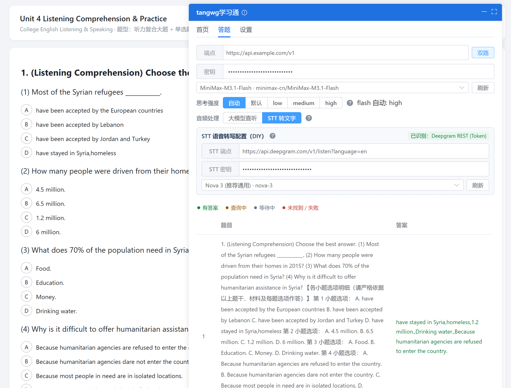
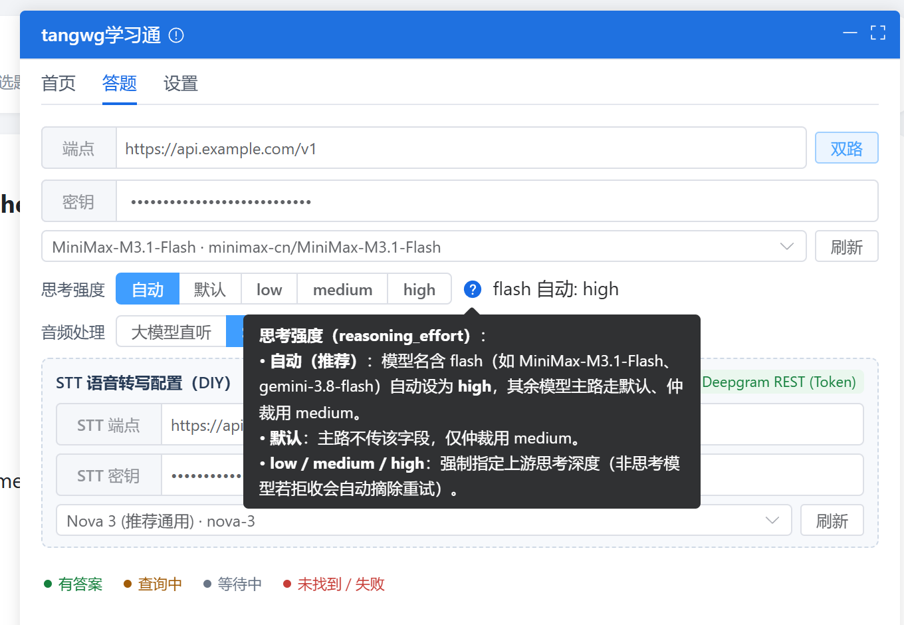
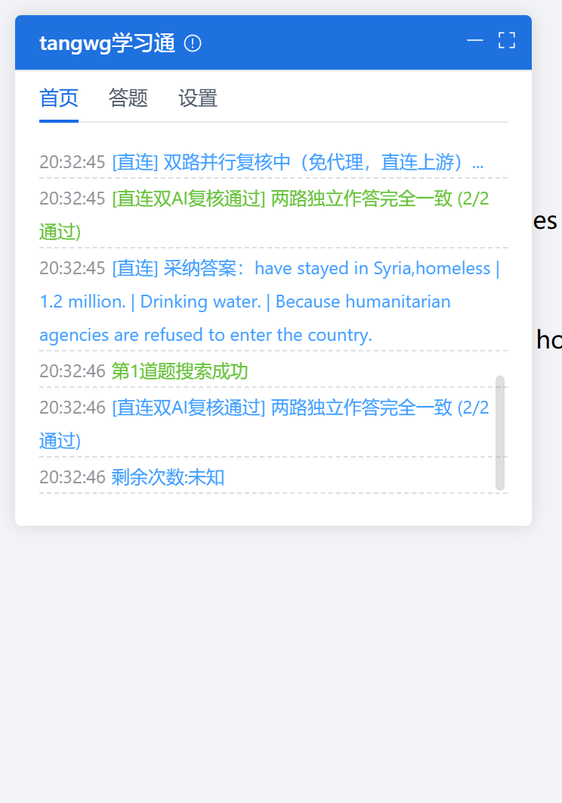

# tangwg-chaoxing（超星学习通｜知到智慧树 AI 答题与听力 STT 助手）

[](./LICENSE)
[](./tangwg学习通.user.js)
[](./llms.txt)

> **完全自托管 / 免代理双链路 LLM + DIY STT 网课辅助油猴脚本与 FastAPI 题库代理**
> 基于上游开源 UserScript 二次深度重构，移除第三方商业题库与卡密绑定，支持浏览器免部署直连任意 OpenAI 兼容大模型、自定义 Deepgram / Whisper 语音转文字（STT）攻克英语听力复合大题、Flash 模型自动 `high` 思考强度，以及双路 AI 复核与第 3 路专家仲裁。
>
> 🤖 **AI / Agent 检索入口**：仓库根目录提供标准 [`llms.txt`](./llms.txt)，方便 AI 搜索引擎与编码 Agent 快速索引架构与文件导航。

---

## 📑 目录索引（Table of Contents）

- [⚠️ 免责声明（Disclaimer）](#️-免责声明disclaimer)
- [📸 真实界面与运行截图](#-真实界面与运行截图)
- [一、最上游来源说明](#一最上游来源说明)
- [二、我们做了哪些核心改动](#二我们做了哪些核心改动)
- [三、完整使用指南（含开发者模式、脚本权限与跨域放行）](#三完整使用指南)
- [四、可选：部署自建题库代理 (`proxy/`)](#四可选部署自建题库代理-proxy)
- [五、仓库文件索引（Repository Structure）](#五仓库文件索引repository-structure)
- [六、常见问题与检索索引（FAQ & Keywords）](#六常见问题与检索索引faq--keywords)
- [七、本地自动化验证](#七本地自动化验证)
- [八、开源协议](#八开源协议)

---

## ⚠️ 免责声明（Disclaimer）

使用本项目前请务必仔细阅读以下条款：

1. **用途限制**：本项目全部代码与文档**仅供个人学习、自动化测试、多模态 AI 工程研究与技术交流使用**。**严禁**将本项目用于任何违反所在学校/机构学术诚信规范、考试纪律、平台服务条款的行为，亦禁止任何形式的商业打包售卖或付费代刷服务。
2. **风险自负**：使用者需自行评估使用第三方浏览器脚本与自动化工具可能带来的账号风控、成绩作废或服务封禁风险；所有通过第三方 AI / STT 接口产生的 API 费用、网络流量与数据合规责任均由使用者自行承担。
3. **无担保声明**：本项目按 MIT 协议按“现状（AS-IS）”提供，作者与贡献者不对题目解答准确率、接口稳定性或因使用本项目导致的任何直接/间接损失承担责任。
4. **侵权联系**：本项目对上游公开脚本的二次开发已严格保留并指明原作者归属；如相关权利方认为存在不当引用，请通过 GitHub Issues 联系，我们将第一时间处理。

---

## 📸 真实界面与运行截图

### 1. 「答题」面板：免部署直连 + Flash 自动 High 思考强度 + DIY STT 听力转写 + 复合大题求解


### 2. 渐进式披露气泡（行内小问号 `?` + Shadow DOM 内嵌富文本 Tooltip）与实时日志
| 行内小问号内嵌浮窗说明（`teleported: false`） | 首页实时执行与 STT 转写/双路复核日志 |
|---|---|
|  |  |

---

## 一、最上游来源说明

本项目最上游源于用户脚本社区作者 **isMobile**（脚本元信息 `@namespace noshuang`，MIT 协议）公开发布的原版脚本：

- **上游名称**：《🥇超星学习通｜知到智慧树--网课小助手》
- **分发平台**：可在 [Greasy Fork](https://greasyfork.org/) 或 [ScriptCat（脚本猫，编号 #711）](https://scriptcat.org/zh-CN/script-show-page/711) 搜索脚本名或作者 `isMobile` / `@namespace noshuang` 查阅原版发布页。
- **原版机制**：原版脚本自带视频接管与章节/作业/考试题目解析逻辑，但题库后端绑定了第三方商业接口（如 `search.tikuhai.com`）与卡密体系，且默认不支持用户自带大模型或语音识别。

---

## 二、我们做了哪些核心改动

在保留上游课程播放与页面解析基础上，本仓库对[客户端脚本](./tangwg学习通.user.js)和[自建题库代理 (`proxy/`)](./proxy/) 进行了全面重构（`0.2.7 → 0.9.0`）：

1. **彻底去商业化与去硬编码**
   - 移除第三方商业题库默认域名、内置地址和卡密硬绑定；面板默认地址与密钥均留空，纯本地持久化（`GM_setValue` + `localStorage`）。
   - 公告通道统一复用用户自行填写的代理端点（`{endpoint}/def/notice`），且不再向任何第三方外传页面 `referer` 与站内 UID。
2. **双链路自动识别（免部署直连上游 / 自建代理）**
   - 面板收口为**单一端点输入框**，按地址结尾自动分流：
     - 填入以 `/v1`（或 `/vN`）结尾的地址 → **浏览器直连模式**，直接由 `GM_xmlhttpRequest` 调用任意 OpenAI 兼容 `/v1/chat/completions` 与 `/v1/models`；
     - 填入站点根地址（如 `https://tiku.example.com`）→ **自建代理模式**，走 [`proxy/`](./proxy/)（FastAPI + SQLite + SSE 流式 + 硬墙钟超时）。
   - **默认启用双路并行复核 + 第 3 路专家仲裁**：`temperature=0.0` 与 `0.3` 并行作答，首路返回有效答案后进入协同宽限等待（防止慢账号拖死整题），双路一致即采纳，分歧时触发第 3 路专家仲裁（可一键切换为「单路」省一半开销）。
3. **「思考强度（`reasoning_effort`）」自适应控制**
   - 面板新增思考强度选择：`自动`（默认）/ `默认` / `low` / `medium` / `high`。
   - 选 **`自动`** 时，**只要当前模型名包含 `flash`（如 `MiniMax-M3.1-Flash`、`gemini-3.8-flash`），主路与仲裁均自动设为 `high`**，否则走默认；不支持 `reasoning_effort` 的非思考模型会在报错后自动摘除字段重试。
   - 客户端与代理端缓存键均已按思考强度隔离，切换档位不会命中旧缓存。
4. **听力音频两条链路：大模型直听 / DIY STT 语音转文字**
   - 自动检索并下载转码课程页面音频，严格隔离跨题子树的兄弟题目与非音频附件（过滤图片/PDF/HTML 误抓），音频获取失败时直接报错中止，绝不静默降级盲猜。
   - **大模型直听**：向原生多模态模型透传 `input_audio`。
   - **DIY STT 转文字**：按端点格式自动适配两类 HTTP 语音转写协议（不硬编码模型与服务商），并内置按音频指纹的转写缓存：
     - **OpenAI 兼容**（`/v1/audio/transcriptions`，`Bearer` 鉴权，兼容硅基流动、Groq、本机回环 Whisper 等）；
     - **Deepgram REST**（`/v1/listen`，自动切换 `Token` 鉴权、直传二进制音频并校验 `results.channels`），明确拦截无法处理整段录音的 `ws://` / `wss://` 端点并给出提示。
5. **复合大题（`type="8"`）与现代网页题型修复**
   - 修复超星新版作业 `.answerBg` / 章节测验 `.TiMu` 复合听力阅读大题清空扁平选项后丢失各小题题干与 `A/B/C/D` 选项的问题；支持剥离 `1. A` / `(2) 选项` 等题号前缀回填，并对未对齐或未命中选项打出警告日志。
6. **界面交互优化与自动化测试**
   - 主面板关键开关（思考强度、音频处理、DIY STT、单双路）均配备**行内小问号 + 内嵌浮窗说明**（关闭 `teleport`，在 Shadow DOM 容器内就近展示，不飘出边界）。
   - 仓库附带完整离线自动化测试：`direct_mode_test.mjs`（107 项直连断言）、`proxy/contract_test.py`（35 项契约与时序断言）、`proxy/e2e_smoke.py`、`proxy/ui_smoke.py`（Chrome Playwright 真浏览器面板冒烟）。

---

## 三、完整使用指南

### 1. 安装脚本管理器并开启浏览器必要权限（关键，缺一不可）

在 Chrome / Edge（尤其 Chromium Manifest V3 环境）运行油猴脚本，**必须**完成下面两项浏览器权限开启，否则脚本不会注入页面：

1. 安装浏览器扩展 **Tampermonkey（篡改猴）**（或 ScriptCat 脚本猫）。
2. 打开浏览器扩展管理页：
   - Chrome 输入 `chrome://extensions`
   - Edge 输入 `edge://extensions`
3. 打开页面右上角（或左侧）的 **「开发者模式（Developer mode）」** 开关。
4. 找到 **Tampermonkey（篡改猴）** → 点击 **「详情（Details）」**：
   - 向下滚动找到 **「允许运行用户脚本（Allow User Scripts）」**（部分旧版叫「允许访问文件网址 / 用户脚本权限」）→ **务必打开**；
   - 按需开启「在无痕模式下启用」；开启后重启浏览器或彻底刷新网课标签页生效。

### 2. 安装脚本并授予「脚本权限 + 跨域访问权限」

1. 打开 Tampermonkey 管理面板 → 点 `+` 号新建脚本（或从 GitHub Raw 链接直接导入），将仓库根目录的 [`tangwg学习通.user.js`](./tangwg学习通.user.js) 全文覆盖粘贴并 `Ctrl+S` 保存，确保状态为「已启用」。
2. **授予脚本跨域权限（`@connect` / 域名放行）**：
   - 脚本头部已声明 `@connect *` 与主流课程站点，但在首次请求你**自填的第三方 AI 接口或 STT 接口域名**（如自定义中转域名、`api.deepgram.com`、`api.siliconflow.cn`、`api.groq.com`、`127.0.0.1` 等）时，Tampermonkey 会弹出 **「一个用户脚本正试图访问跨域资源」** 的安全确认窗口：
     - **请务必点击「始终允许该域名（Always allow domain）」或「允许全部域名（Always allow all domains）」**；
     - 如果误点过拒绝，请前往：Tampermonkey 管理面板 → 选择本脚本 → **「设置（Settings）」** 选项卡 → **「XHR 安全（XHR Security）」→「用户域名白名单（User domain whitelist）」** 中手动放行对应域名（或确认无误拦截），否则面板日志会持续提示 `网络错误` / `请求出错`。

### 3. 在脚本「答题」面板配置凭证

打开任意超星学习通 / 智慧树答题页面，点击脚本面板顶部的 **「答题」** 标签页：

| 模式 | 端点怎么填 | 密钥填什么 | 模型怎么选 |
|---|---|---|---|
| **免部署直连** | 填你的 OpenAI 兼容上游 base（如 `https://api.example.com/v1`） | 上游 API Key（Bearer 鉴权） | 点「刷新」拉取 `/v1/models` 后必选一个，或手输模型名回车 |
| **自建代理** | 填你的 [`proxy/`](./proxy/) 部署站点地址（如 `https://tiku.example.com`，不要带 `/v1`） | 代理 `.env` 里的 `PROXY_TOKEN`（留空则无鉴权） | 留空用服务端 `CPA_MODEL`，或刷新后按题选模型 |

- **思考强度**：默认保持 **`自动`** 即可——当你使用 `MiniMax-M3.1-Flash`、`gemini-3.8-flash` 等名称含 `flash` 的模型时会自动切为 `high`（旁边亮出绿色徽标 `flash 自动: high`）；也支持手动锁定 `low` / `medium` / `high`。
- **听力题音频处理**：
  - 使用原生支持 `input_audio` 的模型时选 **「大模型直听」**；
  - 使用纯文本模型或想降低多模态流量成本时切为 **「STT 转文字」**，再填写：
    - OpenAI 兼容端点：如 `https://api.siliconflow.cn/v1`、`https://api.groq.com/openai/v1`、`http://127.0.0.1:8000/v1`
    - Deepgram REST：填 `https://api.deepgram.com/v1/listen`，模型选 `nova-3`（**英语听力若片头含中文播报，强烈建议将端点写成 `https://api.deepgram.com/v1/listen?language=en` 防语种误判**；暂不支持 `ws://` / `wss://` 实时流式端点）。

---

## 四、可选：部署自建题库代理 (`proxy/`)

如果需要多人共享 30 天 SQLite 答案/转写缓存、避免在浏览器明文存主上游 Key 或应对客户端长耗时超时，可参考 [`proxy/README.md`](./proxy/README.md) 部署后端代理：

```bash
cd proxy
cp .env.example .env   # 填写 CPA_BASE_URL / CPA_API_KEY / PROXY_TOKEN 等
# 部署方法详见 proxy/README.md 与 proxy/deploy.sh
```

---

## 五、仓库文件索引（Repository Structure）

| 路径 | 说明 |
|---|---|
| [`tangwg学习通.user.js`](./tangwg学习通.user.js) | Tampermonkey / ScriptCat 用户脚本本体（`v0.9.0`），内含直连双路复核、DIY STT、思考强度控制与超星/智慧树解析器 |
| [`llms.txt`](./llms.txt) | 面向 AI 搜索引擎与 Agent 的标准化仓库摘要与文件索引 |
| [`direct_mode_test.mjs`](./direct_mode_test.mjs) | 纯 Node 离线单元测试套件（107 项断言，覆盖直连 SSE、选项吸附、STT、Deepgram 与思考强度） |
| [`proxy/server.py`](./proxy/server.py) | FastAPI 题库代理主服务（SQLite 30 天缓存、双路复核、第 3 路仲裁、相似度吸附） |
| [`proxy/upstream.py`](./proxy/upstream.py) | 上游流式调用层、硬墙钟超时截断与 OpenAI / Deepgram STT 适配层 |
| [`proxy/contract_test.py`](./proxy/contract_test.py) | 代理端离线契约与时序测试套件（35 项断言） |
| [`proxy/e2e_smoke.py`](./proxy/e2e_smoke.py) | 本地端到端 uvicorn + 模拟上游冒烟测试 |
| [`proxy/ui_smoke.py`](./proxy/ui_smoke.py) | 基于 Playwright + 真 Chrome 的 Shadow DOM 面板渲染与交互冒烟测试 |
| [`proxy/README.md`](./proxy/README.md) | 题库代理部署、Nginx TLS 反代与调试文档 |
| [`proxy/CHANGELOG.md`](./proxy/CHANGELOG.md) | 详细版本演进与问题排查记录 |

---

## 六、常见问题与检索索引（FAQ & Keywords）

- **Q1：为什么安装了篡改猴脚本，打开超星学习通/智慧树页面却没有任何悬浮窗？**
  - 请检查：① 浏览器 `chrome://extensions` 或 `edge://extensions` 是否已开启**开发者模式**；② 篡改猴扩展「详情」里是否已打开**允许运行用户脚本（Allow User Scripts）**；③ 是否处于题目/章节任务点页面（如 `/mycourse/studentstudy`、`/mooc2/work/dowork`、`/exam-ans/exam`、`/stuExamWeb.html`）。
- **Q2：日志提示「上游网络错误」或「STT 网络错误」怎么解决？**
  - 检查 Tampermonkey 弹出的跨域域名授权窗口是否被拒绝；可在 Tampermonkey → 本脚本「设置」→「XHR 安全 / 用户域名白名单」中放行你的 API 域名，并确认远端接口使用 `HTTPS`（仅 `127.0.0.1` / `localhost` 允许 `HTTP`）。
- **Q3：为什么英语听力题用了 STT 还是做错其中一道小题？**
  - 语音转文字（如 Deepgram `nova-3`）只负责把录音变成英文原文，最终选哪个选项取决于**主答题模型的逻辑推理能力**。建议使用带 `flash` 的模型（默认自动开启 `high` 思考强度）或切换推理能力更强的模型；若录音开头带中文题干播报，可在 Deepgram 端点后加 `?language=en`。

**检索标签（Search Keywords）**：
`超星学习通脚本` · `学习通自动答题` · `知到智慧树网课助手` · `油猴脚本接入大模型` · `学习通英语听力自动答题` · `Deepgram STT 语音转文字` · `Whisper 听力转写` · `OpenAI API 题库代理` · `Chaoxing Xuexitong Userscript` · `Zhihuishu MOOC Helper` · `Tampermonkey Allow User Scripts`

---

## 七、本地自动化验证

在提交修改后可离线跑通全部检查（均使用 Mock 上游，不消耗真实额度）：

```bash
node --check tangwg学习通.user.js
node direct_mode_test.mjs
python proxy/contract_test.py
python proxy/e2e_smoke.py
python proxy/ui_smoke.py
```

---

## 八、开源协议

本项目基于 [MIT License](./LICENSE) 开源。
